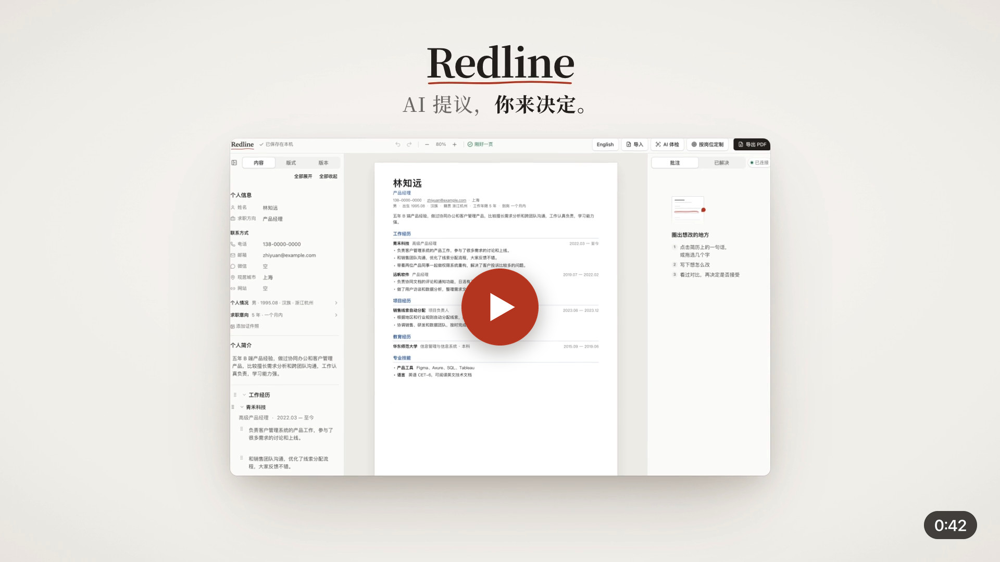
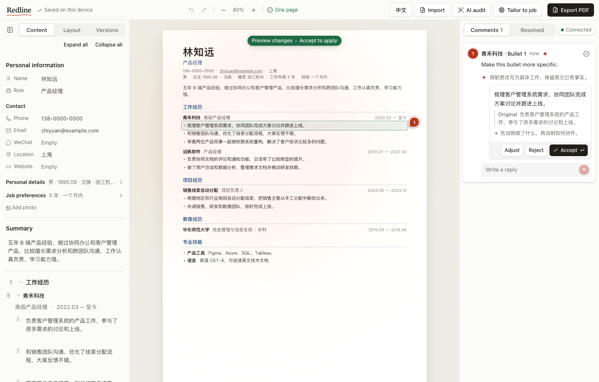

# Redline

Redline is a local-first résumé editor. Edit the sample résumé, compare AI suggestions with the original text, and export to PDF. Suggestions change the résumé after you accept them.

[Try Redline in your browser](https://zixun-ai.github.io/redline-public/) · [Offline HTML](./Redline.html) · [中文使用说明](#中文使用说明)

[](https://zixun-ai.github.io/redline-public/redline-demo.mp4)

The 42-second demo has sound and uses the Chinese interface. It covers asking for a revision, reviewing the changes, checking flagged claims, tailoring to a job, and switching templates.

## Try it

1. Open the demo in desktop Chrome. Select **English** or **中文** to switch the interface. The résumé text stays in its original language.
2. Double-click a line to edit the sample. Choose a template in **Layout**, then select **Export PDF**. These steps work without an API key.
3. To try AI review, add your own key in **Comments**. Select text on the résumé and ask for a revision. Compare the suggestion with the original, then accept, adjust, or reject it.

## How review works



The screenshot uses the sample résumé and a simulated AI suggestion.

- **Review before applying.** Preview changes on the résumé. For suggestions with multiple edits, choose which ones to apply. Undo changes from the editor.
- **Check added claims.** Redline flags some new claims that lack support in the source text. Check the evidence before you accept them.
- **Keep a local copy.** Résumés, comments, and versions stay in browser storage. When you use AI, Redline sends the text required for that action to the provider you choose.
- **Verify the release.** The Chrome tests use simulated AI responses. They cover editing, review, storage, and PDF export across all 21 templates. See the commands below.

## 中文使用说明

[观看 42 秒演示视频](https://zixun-ai.github.io/redline-public/redline-demo.mp4)（中文界面，有声音）。

在画布或左栏编辑简历。选中文字后，可以留下批注，让 AI 提出修改建议。你可以预览、调整、拒绝或接受修改。打开在线版即可编辑示例、切换版式和导出 PDF。

- 使用：直接用桌面 Chrome 打开 `Redline.html`。点右上角的 **English** 或 **中文** 可切换界面，浏览器会记住选择。切换界面不会修改简历正文和纸面标签。本地编辑不需要 Key；使用 AI 时填入对应服务的 API Key。
- 编辑：点击组件选择“直接编辑”，或双击正文修改。占位符可直接填写；模块、条目、要点可拖动调序，也保留上下移动按钮和撤销。左栏支持全部展开与收起。正文支持 `**加粗**` 和网址链接；引用批注可跨段选择，多个批注的图钉可逐条定位。
- 审阅：可逐条接受、拒绝、微调或部分接受 AI 建议。新增数字、经历和职责仍须核对。无需岗位描述也能运行“AI 体检”；岗位定制区分 AI 判断的已有依据和待补充项，保留最近 5 份匹配摘要供切换。
- 模板：共 21 款，按简洁、正式、双栏、创意、侧重点分类，可按名称或用途搜索。包括单栏、左右侧栏、双列、左侧模块标题、时间线和卡片等结构。校园、能力、项目模板只调整模块显示顺序，不改存储中的正文与顺序。
- 排版与导出：可选 1 页、2 页或不限页数，超过所选上限时阻止导出。默认示例在 21 款模板中按一页 A4 验证，任意正文不保证一页；压缩到一页失败会恢复原版式。多页按浏览器打印规则分页，界面页数为估算，请核对打印预览。支持 PDF、Markdown 和纯文本导出。“简素”采用纯文字单栏，但不保证所有招聘系统都能正确读取。
- 外观与版本：可选深色或浅色界面，简历纸面保持白色；内置标签可切换中英文，正文需自行翻译。可调整模块主栏/侧栏位置及照片形状。照片支持拖动、缩放和裁切；版本支持重命名、对比正文与版式差异、恢复。
- 多开：同一本机存档只允许一个自动保存的编辑页。先关闭原编辑页，再在新页点击“重新打开”。浏览器无法取得独占锁时，可用临时会话编辑；临时页不自动保存到本机，关闭前请下载备份。更新 HTML 时也请先关闭旧版编辑页。
- 导入：支持 PDF、Word（`.docx`）、TXT 和 Markdown。文件不超过 10 MB，PDF 不超过 20 页，文字不超过 50000 字。加密 PDF 需先解密，扫描版需先转成可复制文字；应用不提供 OCR。照片不超过 10 MB、4000 万像素，保存时缩小为 300 × 420。
- 数据：简历、批注、版本及岗位匹配摘要、已有依据和缺项存入浏览器 IndexedDB，一次保存作为一个事务提交；原岗位描述全文不持久保存。首次打开新版会迁移旧 localStorage 数据；只写入变化的内容。保存失败会显示提示，此时请及时下载备份。备份不含 API Key，恢复文件不超过 10 MB。
- AI 连接：默认地址 `https://api.deepseek.com`、模型 `deepseek-flash`，可改成兼容 OpenAI Chat Completions 的地址和模型；支持 `/v1` 路径。服务须允许浏览器跨域请求。地址只允许 HTTPS，本机地址可用 HTTP；修改地址会清空正在输入的 Key，并取消旧验证。连接弹窗显示目标域名和模型。
- Key：默认只在当前页面内存中使用，刷新或关闭后清除。主动勾选“记住 API Key”才存入此浏览器的 localStorage；服务设置和可选 Key 保存在同一条连接记录中。旧版 Key 仅在没有新连接记录时迁移到官方地址，可取消记住或移除。连接设置本身会保留。
- 发送范围：请求由浏览器直接发给连接弹窗显示的服务。验证 Key 只发送测试消息；导入发送所选原文全文；批注发送选中组件、必要背景和当前批注对话，修改基本信息组件时会发送该组件中的姓名、联系方式等内容。岗位定制发送岗位描述及待审正文；体检只发送待审正文，两者不附带基本联系字段、经历时间字段或历史批注。以上请求都不附带照片，但正文中自行写入的信息仍会发送。
- 请求进度：导入、岗位定制和体检会显示接收的字符数。完整回复通过校验后才生成核对结果或建议；取消会丢弃未完成结果。兼容普通 JSON 回复，失败后不会自动重复发送付费请求，可由你手动重试。

开发需要 Node.js ≥ 22.13（推荐 24）和 npm。先运行 `npm ci`，再运行 `npm run dev`。`npm run build` 先检查 TypeScript，再生成单文件 `dist/index.html`。

```sh
npm test                 # 单元测试，不需要 Chrome
npm run verify:release   # 完整验证，成功后更新 Redline.html
```

`verify:release`（也可用 `npm run release`）只构建一次，然后依次运行单元测试、全部 E2E 及七条核心流程。E2E 包括审查回归、临时会话、21 款模板、AI 流式请求、画布编辑、左栏功能和分页导出。浏览器测试使用隔离存储，AI 回复由本地模拟，不使用真实 Key。PDF 和图片素材在本次独立目录中生成，不复用旧文件；九组报告必须来自本次构建、包含案例且全部通过，新增功能的必测案例也不能缺少。全部通过后才更新 `Redline.html`，并核对它与已验证构建的 SHA-256；任一步失败都保留原交付文件。证据在 `e2e/out/release/<本次运行>/`。

完整回归需要 macOS、已安装的 Google Chrome 和 poppler（`brew install poppler`）；Word 测试还使用 macOS 自带 `textutil`。浏览器支持和自动验证范围为桌面 Chrome，未验证 Safari、Firefox、真实 AI 回复质量、任意兼容服务或系统打印对话框。单独调试浏览器检查可运行 `npm run build && npm run e2e`；核心流程说明见 [验证技能](.claude/skills/verify-redline/SKILL.md)。

Redline 源代码使用 [MIT 许可证](LICENSE)。随单文件版分发的依赖见 [第三方许可声明](THIRD_PARTY_NOTICES.txt)。
